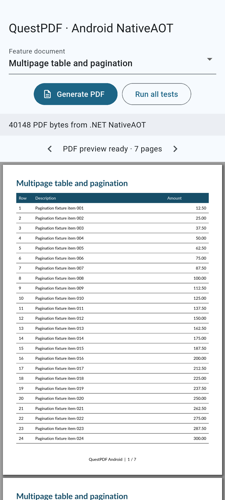
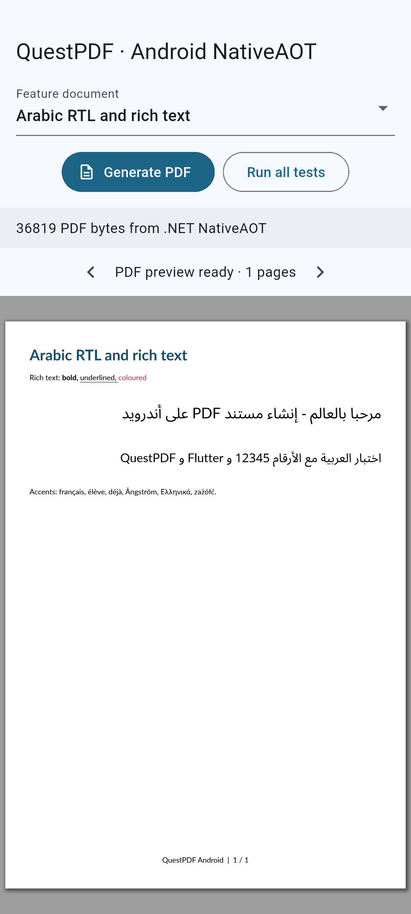
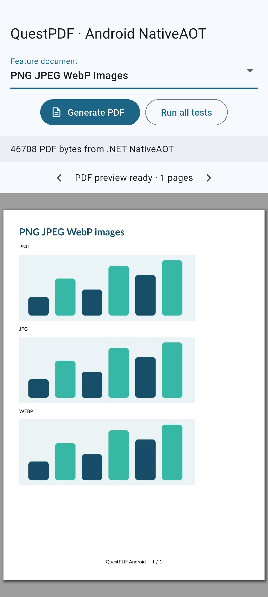
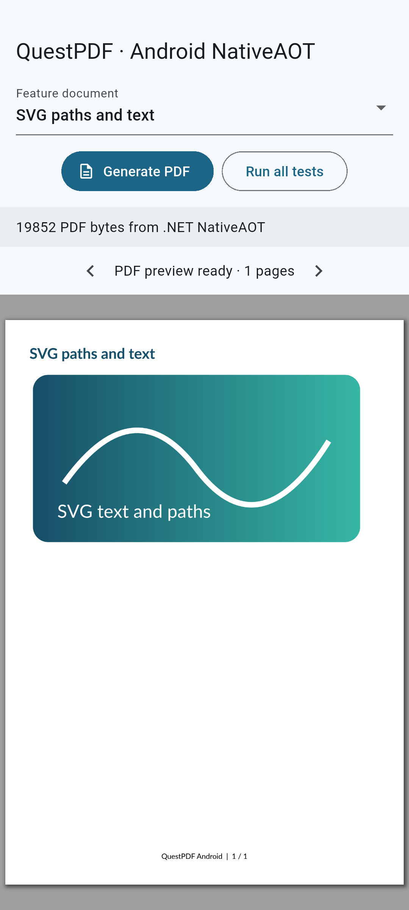
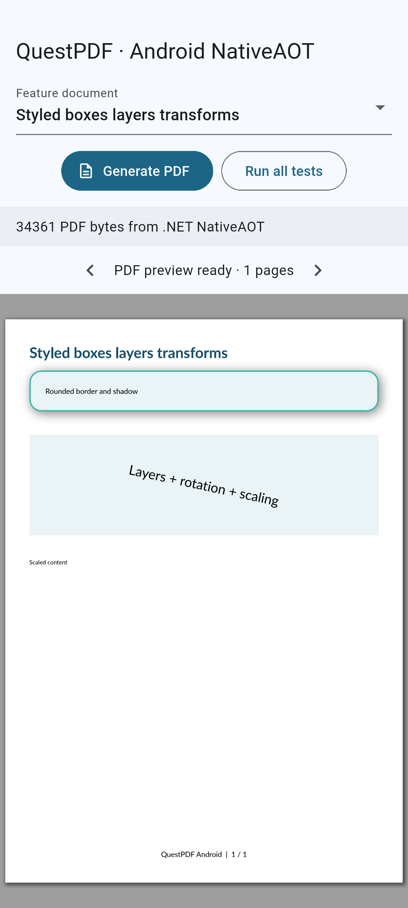

# QuestPDF on Android

This fork adds Android native assets to QuestPDF, with a working C# NativeAOT document
generator and a Flutter app that receives PDF bytes through Dart FFI and previews them
using pdfrx. Use this fork's source or a package built from it; installing the upstream
`QuestPDF` NuGet package alone does not supply this fork's Android changes.

## Test app previews

These screenshots were captured from the running Flutter test app on an Android
x86-64 emulator. Each preview displays PDF bytes generated locally by the C# NativeAOT
library and rendered by pdfrx. They show tables and pagination, Arabic shaping and
right-to-left mixed text, raster images, SVG paths, and drawing transforms.

| Tables and pagination | Arabic and RTL | PNG / JPEG / WebP images |
| --- | --- | --- |
|  |  |  |

| SVG paths and text | Borders, shadows, layers and transforms |
| --- | --- |
|  |  |

## Recommended application structure

**Create a dedicated C# project that owns document generation and can be compiled to
NativeAOT as a shared native library.** Keep document templates, fonts, validation and
business rules in that project. Export a small C ABI and call it from Flutter using
`dart:ffi`, with Dart bindings generated from the C header using **ffigen**:

```text
Flutter UI → Dart FFI → your C# NativeAOT shared library → QuestPDF
                                                          ├─ libquestpdf_skia.so
                                                          └─ libquestpdf_qpdf.so
Flutter UI ← copied PDF bytes ← native output buffer
    └─ pdfrx preview
```

The application packages the compiled library and its native dependencies. A separate
.NET installation on the phone is unnecessary. NativeAOT exports methods annotated
with `UnmanagedCallersOnly` and an explicit entry point; see Microsoft's
[native library documentation](https://learn.microsoft.com/en-us/dotnet/core/deploying/native-aot/libraries).
Do not unload the NativeAOT library during the app's lifetime.

Choose dependencies that support trimming and NativeAOT. Avoid runtime code generation
and unbounded reflection-based discovery; use explicit registrations or source
generation, including for JSON models passed across your own API. Treat AOT/trimming
warnings as issues to investigate. Dart calls the C ABI directly, so this sample does
not need a Java/Kotlin method-channel bridge.

## Supported targets

| Android ABI | QuestPDF Android asset RID | Standalone NativeAOT RID | Flutter target |
| --- | --- | --- | --- |
| `armeabi-v7a` | `android-arm` | `linux-bionic-arm` | `android-arm` |
| `arm64-v8a` | `android-arm64` | `linux-bionic-arm64` | `android-arm64` |
| `x86_64` | `android-x64` | `linux-bionic-x64` | `android-x64` |

The sample's minimum Android version is **Android 7 / API 24**. The bridge uses .NET 10;
the checked-in native assets come from the pinned QuestPDF Skia and qpdf sources in
[`native/android/sources.json`](native/android/sources.json). They implement QuestPDF's
own wrapper ABI, rather than the SkiaSharp API. Skia handles drawing, text, fonts,
images and PDF generation; qpdf handles operations such as merging, attachments and
encryption.

Standalone Android/Bionic NativeAOT is experimental. Its `linux-bionic-*` RIDs differ
from the `android-*` RIDs used by the .NET Android workload. This setup uses the
[.NET runtime's Bionic publishing workflow](https://github.com/dotnet/runtime/blob/release/10.0/src/coreclr/nativeaot/docs/android-bionic.md),
including the runtime-pack properties in the supplied project and publish script.

## Build and run the included app

The verified toolchain used Windows, .NET SDK 10.0.302, runtime packs 10.0.10,
Flutter 3.47.2 / Dart 3.13.2, and Android NDK r29 (`29.0.14206865`). Install the Android
SDK, accept its licenses, and put Flutter, .NET and `adb` on `PATH`. Set `ANDROID_HOME`
to your SDK directory. pdfrx also needs its documented native C build toolchain; consult
the [package requirements](https://pub.dev/packages/pdfrx).

The following PowerShell commands run from the repository root. They reuse the
checked-in Skia/qpdf libraries, stage them where the publish script expects native
build outputs, and compile the C# bridge for all three ABIs:

```powershell
$ndk = Join-Path $env:ANDROID_HOME 'ndk/29.0.14206865'
$targets = @{
    'armeabi-v7a' = 'arm'
    'arm64-v8a' = 'arm64'
    'x86_64' = 'x64'
}
foreach ($abi in $targets.Keys) {
    $cpu = $targets[$abi]
    $destination = "artifacts/android/$abi"
    New-Item -ItemType Directory -Force $destination | Out-Null
    Copy-Item "src/dotnet/library/QuestPDF/Runtimes/android-$cpu/native/*.so" $destination
    ./scripts/publish_android_bridge.ps1 -Abi $abi -Ndk $ndk
    if ($LASTEXITCODE -ne 0) { throw "Publishing $abi failed" }
}

Set-Location samples/flutter_android
flutter pub get
flutter build apk --profile --target-platform "android-arm,android-arm64,android-x64"
adb devices
adb -s <device-serial> install -r build/app/outputs/flutter-apk/app-profile.apk
adb -s <device-serial> shell am start -n com.questpdf.questpdf_android_demo/.MainActivity
```

Replace `<device-serial>` with an actual device/emulator serial. To build only one ABI,
run that ABI's publish step and pass the corresponding Flutter target, for example
`flutter build apk --profile --target-platform android-x64` for an x86-64 emulator.
Use **Generate PDF** to preview a fixture, **Run all tests** to execute the native
feature suite, and the arrows to navigate the multipage document.

Native outputs go into `samples/flutter_android/android/app/src/main/jniLibs/<ABI>/`.
These generated sample libraries and APKs are ignored by Git. Rebuilding the native
forks instead of reusing their checked-in assets requires Python 3, Git, CMake, Ninja
and a host C compiler; follow the [engineering build guide](docs/android-arm64.md#build-and-run).

## Put your document generator in C#

Start from [`QuestPdf.Android.Native.csproj`](samples/dotnet/QuestPdf.Android.Native/QuestPdf.Android.Native.csproj)
and [`Exports.cs`](samples/dotnet/QuestPdf.Android.Native/Exports.cs). The project already
references this fork's QuestPDF project and enables:

```xml
<TargetFramework>net10.0</TargetFramework>
<PublishAot>true</PublishAot>
<NativeLib>Shared</NativeLib>
<AssemblyName>questpdf_android</AssemblyName>
<AllowUnsafeBlocks>true</AllowUnsafeBlocks>
<IsAotCompatible>true</IsAotCompatible>
```

Retain the sample's conditional Bionic runtime-pack settings and 16 KB linker
arguments as well. Use [`publish_android_bridge.ps1`](scripts/publish_android_bridge.ps1)
to publish it; if you move or rename the project, update the script's project/output
paths and the project's QuestPDF reference. Keeping the assembly name above lets you
reuse the existing Android filename and Dart bindings.

For a minimal custom document, add this class to the sample C# project:

```csharp
using QuestPDF.Fluent;
using QuestPDF.Helpers;
using QuestPDF.Infrastructure;

namespace QuestPdf.Android.Native;

public static class InvoiceDocument
{
    private static readonly object InitLock = new();
    private static bool initialized;

    public static byte[] Generate(string cacheDirectory)
    {
        lock (InitLock)
        {
            if (!initialized)
            {
                Directory.CreateDirectory(cacheDirectory);
                // Choose the license appropriate to your organization.
                // Community is only valid if you qualify under QuestPDF's license.
                QuestPDF.Settings.License = LicenseType.Community;
                QuestPDF.Settings.FontDiscoveryPath = null;
                QuestPDF.Settings.TemporaryStoragePath = cacheDirectory;
                initialized = true;
            }
        }

        return Document.Create(document => document.Page(page =>
        {
            page.Size(PageSizes.A4);
            page.Margin(36);
            page.DefaultTextStyle(style => style.FontFamily("Lato").FontSize(12));
            page.Header().Text("Invoice #1001").FontSize(24).Bold();
            page.Content().PaddingVertical(20).Column(column =>
            {
                column.Spacing(8);
                column.Item().Text("Customer: Example customer");
                column.Item().Text("Document generated on Android by C# NativeAOT.");
                column.Item().Text("Total: 125.00").Bold();
            });
            page.Footer().AlignCenter().Text(text => text.CurrentPageNumber());
        })).GeneratePdf();
    }
}
```

In `Exports.Generate`, replace `FeatureSuite.Generate(feature, path)` with
`InvoiceDocument.Generate(path)`. Keep the existing exception handling, output
allocation and `questpdf_free` export. This simple example ignores the feature ID;
a production bridge can use it to select templates or expose a versioned API that
accepts UTF-8 JSON request data. Keep the test suite while iterating, or remove
`questpdf_run_tests` and its `FeatureSuite` references together when extracting a
standalone application library.

Configure library settings once before generation, with one stable app cache path.
This fork embeds the default Lato fonts. For Arabic or other custom fonts, embed font
files in the C# project and register their streams with `FontManager`; see
[`FeatureSuite.Initialize`](samples/dotnet/QuestPdf.Android.Native/FeatureSuite.cs).
APK assets are not ordinary filesystem paths. Review the [QuestPDF license](LICENSE.md)
before distributing your app.

## Package the native libraries in your Android app

Include these files **for each ABI you ship** under your Flutter app's
`android/app/src/main/jniLibs/`:

```text
jniLibs/
  arm64-v8a/
    libquestpdf_android.so   # your C# NativeAOT document generator
    libquestpdf_skia.so      # QuestPDF drawing/text/PDF wrapper
    libquestpdf_qpdf.so      # QuestPDF PDF-operations wrapper
  armeabi-v7a/               # the same three filenames, compiled for ARMv7
  x86_64/                   # the same three filenames, compiled for x86-64
```

Use `minSdk = 24` and select only ABIs for which every required native dependency is
present. The sample's [`build.gradle.kts`](samples/flutter_android/android/app/build.gradle.kts)
maps Flutter targets to matching ABI filters. Do not mix libraries from different
architectures or substitute Linux/glibc `.so` files. pdfrx packages its own PDFium
dependencies separately.

## Flutter / Dart FFI example with ffigen

**Use [ffigen](https://pub.dev/packages/ffigen) to generate the native bindings instead
of maintaining function typedefs and symbol lookups by hand.** Keep the C header in
sync with your C# exports and regenerate bindings whenever the ABI changes. ffigen
generates the Dart declarations; you still publish and package the NativeAOT library
and its dependencies as described above.

Add the runtime dependencies used by the test app, plus ffigen as a development dependency:

```yaml
dependencies:
  flutter:
    sdk: flutter
  ffi: ^2.2.0
  path_provider: ^2.1.6
  pdfrx: ^2.10.0
dev_dependencies:
  ffigen: ^23.0.0
```

### Generate bindings from the C header

Install LLVM/libclang on the development machine following the
[ffigen setup instructions](https://pub.dev/packages/ffigen#requirements). It is a
build-time dependency. Use the programmatic Dart generator API; ffigen's YAML
configuration is deprecated.

In `samples/flutter_android`, create `tool/ffigen.dart`:

```dart
import 'dart:io';
import 'package:ffigen/ffigen.dart';

Future<void> main(List<String> args) async {
  final root = Platform.script.resolve('../');
  final generator = FfiGenerator(
    input: Input(entryPoints: [
      root.resolve('../../native/android/questpdf_android.h'),
    ]),
    output: Output(
      dart: DartOutput(path: root.resolve('lib/questpdf_bindings.g.dart')),
      style: const DynamicLibraryBindings(wrapperName: 'QuestPdfBindings'),
    ),
    visitors: [
      Visitor(func: (node) => node.isIncluded = node.name.startsWith('questpdf_')),
    ],
  );
  await generator.generate(
    libclangDylib: args.isEmpty ? null : Uri.file(args.single),
  );
}
```

The header path above is relative to the included Flutter sample. In your own app,
copy [`questpdf_android.h`](native/android/questpdf_android.h) into a maintained native
API directory and update the path. Keep fixed-width C types and the same exported
signatures as your NativeAOT project. Run from the Flutter project directory:

```powershell
flutter pub get
dart run tool/ffigen.dart
```

If libclang is installed outside the default LLVM locations, pass its absolute
library path, for example `dart run tool/ffigen.dart C:/path/to/libclang.dll` on Windows.

Commit the generated `lib/questpdf_bindings.g.dart` alongside its generator and header;
regenerate it after changing the contract. Do not edit generated bindings manually.
`DynamicLibraryBindings` generates a wrapper around `DynamicLibrary.open`, matching
the sample's explicit `jniLibs` packaging.

### Wrap the generated calls and manage output memory

Save the following as `lib/native_bridge.dart`. It uses the generated
`QuestPdfBindings` class to call the version-1 sample ABI. PDF generation runs on a
worker isolate; the output buffer is copied into Dart memory before its owning
native library frees it. ffigen does not manage buffer ownership or move work off the
UI isolate, so keep this wrapper. See also the
[Dart C interop guide](https://dart.dev/interop/c-interop).

```dart
import 'dart:convert';
import 'dart:ffi';
import 'package:ffi/ffi.dart';
import 'package:flutter/foundation.dart';
import 'questpdf_bindings.g.dart';

Uint8List _generate((int, String) request) {
  DynamicLibrary.open('libquestpdf_skia.so');
  DynamicLibrary.open('libquestpdf_qpdf.so');
  final bindings = QuestPdfBindings(
    DynamicLibrary.open('libquestpdf_android.so'));
  if (bindings.questpdf_abi_version() != 1) {
    throw StateError('Unsupported QuestPDF bridge ABI');
  }
  final path = request.$2.toNativeUtf8();
  final output = calloc<Pointer<Uint8>>();
  final length = calloc<Int32>();
  try {
    final status = bindings.questpdf_generate(
      request.$1, path.cast<Char>(), output, length);
    if (length.value < 0 || (length.value != 0 && output.value == nullptr)) {
      throw StateError('Invalid native output buffer');
    }
    final bytes = Uint8List.fromList(length.value == 0
      ? <int>[] : output.value.asTypedList(length.value));
    if (status != 0) {
      throw StateError('QuestPDF status $status: ${utf8.decode(bytes)}');
    }
    return bytes;
  } finally {
    if (output.value != nullptr) bindings.questpdf_free(output.value.cast());
    calloc.free(length);
    calloc.free(output);
    calloc.free(path);
  }
}

Future<Uint8List> generatePdf(String cacheDirectory, {int feature = 0}) =>
    compute(_generate, (feature, cacheDirectory));
```

The ABI returns status `0` with PDF bytes, `1` with UTF-8 diagnostics, or `2` for
invalid output arguments. The length is a signed 32-bit integer on every ABI; buffers
are not NUL-terminated. Always use `questpdf_free` for native output, including errors.
Use `calloc.free` only for memory allocated on the Dart side. The complete contract is
in [`questpdf_android.h`](native/android/questpdf_android.h).

Use the bridge in `lib/main.dart` and display its bytes with `PdfViewer.data`:

```dart
import 'dart:typed_data';
import 'package:flutter/material.dart';
import 'package:path_provider/path_provider.dart';
import 'package:pdfrx/pdfrx.dart';
import 'native_bridge.dart';

void main() => runApp(const MaterialApp(home: PdfPreviewScreen()));

class PdfPreviewScreen extends StatefulWidget {
  const PdfPreviewScreen({super.key});

  @override
  State<PdfPreviewScreen> createState() => _PdfPreviewScreenState();
}

class _PdfPreviewScreenState extends State<PdfPreviewScreen> {
  late final Future<Uint8List> document;

  @override
  void initState() {
    super.initState();
    document = loadDocument();
  }

  Future<Uint8List> loadDocument() async {
    final cache = await getApplicationCacheDirectory();
    return generatePdf(cache.path);
  }

  @override
  Widget build(BuildContext context) => Scaffold(
    appBar: AppBar(title: const Text('QuestPDF on Android')),
    body: FutureBuilder<Uint8List>(
      future: document,
      builder: (context, snapshot) {
        if (snapshot.hasError) {
          return Center(child: Text('PDF generation failed: ${snapshot.error}'));
        }
        if (!snapshot.hasData) {
          return const Center(child: CircularProgressIndicator());
        }
        return PdfViewer.data(snapshot.requireData, sourceName: 'invoice.pdf');
      },
    ),
  );
}
```

With the unmodified sample bridge, feature `0` generates its overview fixture. After
the C# replacement above, the same Dart call generates your invoice. For an example
with fixture selection, status, test results and page navigation, see the full
[`Flutter sample`](samples/flutter_android).
The checked-in test app currently keeps its small handwritten binding implementation
for reference; the recommended application integration above uses generated bindings.

## Verification and platform limits

The recorded emulator checks cover 22 essential feature fixtures: pagination and
tables, Arabic RTL/rich text/fonts, PNG/JPEG/WebP, SVG, drawing and transformations,
links, dynamic/lazy content, PDF/A and tagged PDF generation, qpdf merging and overlays,
attachments, AES encryption, raster/SVG exports, expected errors, repeated/concurrent
generation, XMP metadata and system fonts. Independent parsing/rendering checked all
22 PDFs / 36 pages; Flutter integration rendered all 36 pages and checked links,
error recovery and preview navigation. Windows managed regressions passed 559 tests.

**Physical ARM64 device:** the repository user reports testing ARM64 on a real
**HONOR X70 running Android 16**. This adds physical-device testing to the emulator
results above. The report does not specify an automated suite result or kernel page
size, so those details are not inferred from the device test.

Run the native suite from the repository root after publishing the selected ABI:

```powershell
./scripts/test_android_bridge.ps1 -Serial <device-serial> -Abi x86_64
```

For the Flutter integration test, build the test entry point, then use the helper
from the repository root:

```powershell
Push-Location samples/flutter_android
flutter build apk --profile --target-platform android-x64 --target integration_test/app_test.dart
Pop-Location
./scripts/run_android_flutter_test.ps1 -Serial <device-serial> -Abi x86_64
```

Use the matching ABI/Flutter target when testing ARM. Important evidence boundaries:

- Physical ARMv7 hardware remains untested. Local automated ARM64 verification on
  this Windows machine used Android ARM translation; an ARM64 Flutter profile/AOT
  build passed, while a debug/JIT build crashed in the translator before document
  generation. Physical ARM64 testing is reported above for the HONOR X70 / Android 16.
- ARMv7 passed on a classic Android API 24 ARM system emulator using software
  rendering. The API 30 x86-64 image's ARMv7 translator crashed in the JPEG fixture;
  identical libraries passed that fixture on the ARM emulator. The classic-emulator
  test helper needs `-SoftwareRendering`. Prefer x86-64 for normal host iteration.
- All three QuestPDF libraries have 16 KB ELF segment alignment on all three ABIs.
  The tested APK's ARM64/x86-64 dependencies also passed alignment checks. The
  pdfrx-supplied ARM32 `libpdfium.so` has 4 KB ELF alignment. A real 16 KB-page Android
  kernel has not been tested; alignment checks alone do not prove that runtime flow.
- PDF/A and PDF/UA generation tests are not formal standards certification.
- The demo is a profile APK signed with the Android debug key. Configure your own
  release signing and review dependencies before distributing an application.

See the [native architecture, source pins, build plan and measured results](docs/android-arm64.md)
for detailed reproduction instructions and the [sample README](samples/flutter_android/README.md)
for additional test commands.
